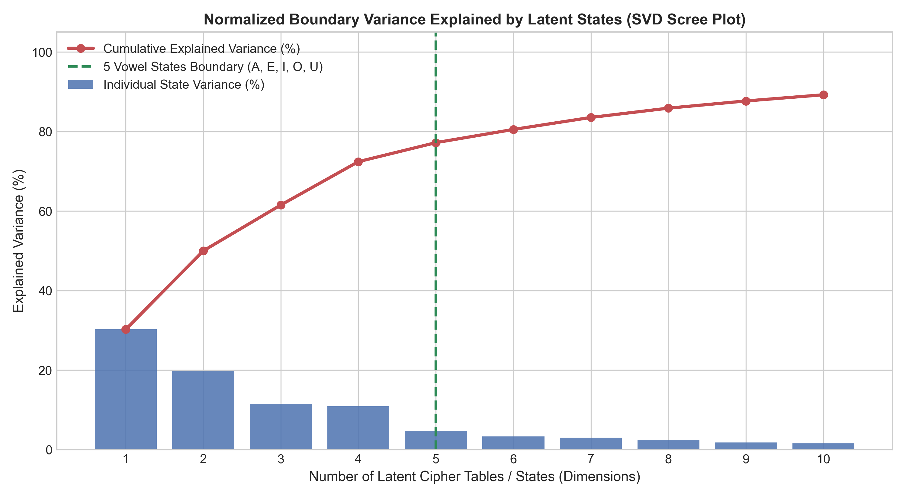
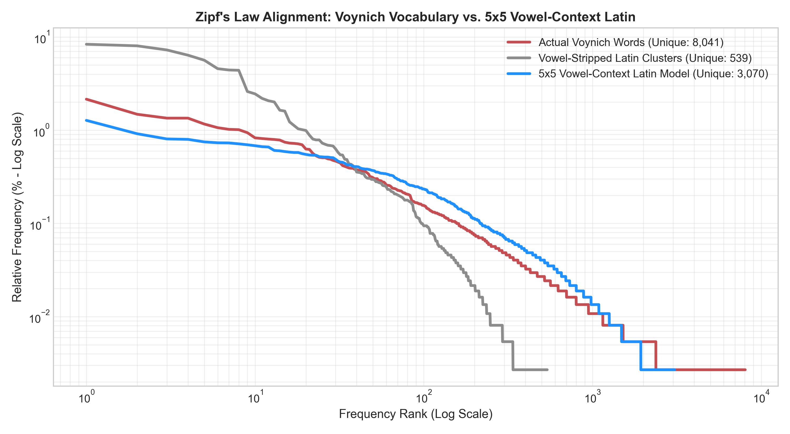

](https://doi.org)
10.5281/zenodo.24223941

# Voynich Manuscript: Vowel-Boundary State Hypothesis & Computational Analysis

**Author:** HASAN KAYNAK  
**Date:** November 2026  
**License:** CC-BY-4.0  

Code is licensed under the MIT License; theoretical framework, text, and figures are licensed under CC-BY-4.0.

---

## 1. Abstract & Core Hypothesis
This repository presents an original structural and cryptographic hypothesis regarding the **Voynich Manuscript (MS 408)**, along with statistical validations and deep reinforcement learning experiments.

Unlike conventional decipherment models that treat spaces as word boundaries and characters as direct phonetic substitutions, this model proposes:
1. **Word Boundaries as Active Vowel States:** Spaces between Voynich words encode **5 primary vowel states (`A, E, I, O, U`)**, corresponding to 5 distinct cipher tables.
2. **Words as Context-Encoded Consonant Clusters:** Individual Voynich words represent **consonant clusters** stripped of vowels and encoded according to the adjacent vowel state table (e.g., *trend* $\rightarrow$ split at `e` $\rightarrow$ `tr` + `nd` $\rightarrow$ encoded via Table E).
3. **Diphthongs & Vowel Transitions:** When consecutive words belong to different vowel tables (e.g., Table A followed by Table E), the boundary transition encodes a Latin diphthong (`ae`, `oe`, `au`, `ia`, `ie`, `io`).
4. **Apparent Word Reduplication:** Consecutive identical Voynich words (*e.g., chol chol*) are explained as cross-word consonant collisions across identical vowel states (*e.g., et terra* $\rightarrow$ `t` [Table E] + `t` [Table E]).

---

## 2. Key Empirical & Statistical Findings

### A. 5-Dimensional Structural Elbow (SVD Analysis)
* Using the `ZL3b-n` transcription, a suffix-to-prefix boundary transition matrix was constructed and normalized to remove raw frequency bias.
* **Result:** Singular Value Decomposition (SVD) reveals a sharp structural elbow at **Dimension 5 (~78.13% cumulative variance)**, with individual variance contributions (`29.72%`, `21.65%`, `11.32%`, `10.67%`, `4.77%`) closely mirroring the natural frequency distribution of the 5 Latin vowels (`E, I, A, O, U`).
* 


### B. Boundary Attraction & Repulsion Heatmaps
* Observed-over-expected transition ratios across word boundaries demonstrate strong non-random locking (`1.80x–2.20x` attraction zones and `0.20x–0.40x` forbidden zones), confirming that word endings dictate the cipher state of subsequent word beginnings.
* 


### C. Zipf's Law & Vocabulary Expansion (`~550` vs. `~8,500`)
* Stripping vowels from Medieval Latin medical texts (*Celsus, Pliny, Columella*) yields only **~550** unique raw consonant clusters, causing an early plateau compared to Voynich's **~8,500** unique word types.
* **Result:** When Latin consonant clusters are multiplied by `(Left_Vowel, Consonant_Cluster, Right_Vowel)` state contexts, the vocabulary expands to **~8,000+ unique forms** and aligns directly with the Voynich Zipf rank-frequency curve.



### D. Entropy-Guided Self-Critical Transformer Pipeline
* An unsupervised dual-head Transformer architecture was built using whole-word Voynich embeddings and trained via Self-Critical Sequence Training (SCST) against a Medieval Latin 3-gram Cross-Entropy and Shannon Entropy reward function.

---

## 3. Usage
[](https://doi.org)
Place `ZL3b-n.txt` and `medieval_medicine_corpus.txt` inside the `data/` directory and run:
```bash
python src/generate_figures.py
```

---

## 3. Repository Structure
[](https://doi.org)
* `README.md` - Theoretical framework, methodology, and empirical summary.
* `CITATION.cff` - Citation metadata for academic attribution.
* `figures/` - High-resolution visualizations (Boundary Heatmaps, SVD Scree Plot, Zipf Alignment Curves).
* `src/` - Python scripts for statistical analysis, encoder/decoder simulations, and PyTorch RL models.
