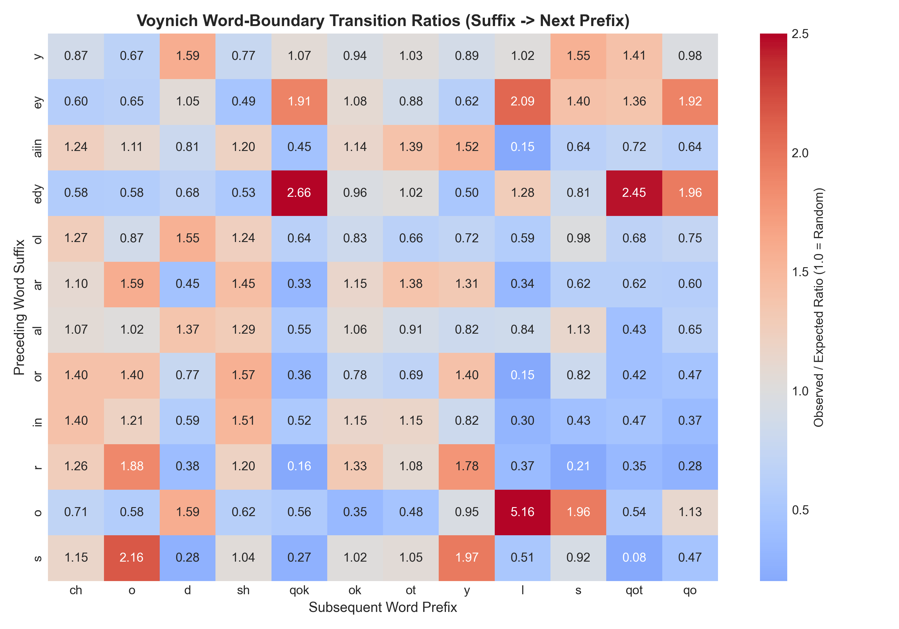

[[](https://doi.org)](https://doi.org/10.5281/zenodo.24223941)

# Voynich Manuscript: Vowel-Boundary State Hypothesis & Computational Analysis

**Author:** HASAN KAYNAK  
**Date:** November 2026  
**License:** Code under MIT License | Text, Theory & Figures under CC-BY-4.0

Code is licensed under the MIT License; theoretical framework, text, and figures are licensed under CC-BY-4.0.

---

## 1. Abstract & Core Hypothesis
This repository presents an original structural and cryptographic hypothesis regarding the **Voynich Manuscript (MS 408)**, along with statistical validations.

Unlike conventional decipherment models that treat spaces as word boundaries and characters as direct phonetic substitutions, this model proposes:
1. **Word Boundaries as Active Vowel States:** Spaces between Voynich words encode **5 primary vowel states (`A, E, I, O, U`)**, corresponding to 5 distinct cipher tables.
2. **Words as Context-Encoded Consonant Clusters:** Individual Voynich words represent consonant clusters stripped of vowels and encoded according to their adjacent (primarily preceding) vowel state table (e.g., Latin *herba* $\rightarrow$ split at *e* $\rightarrow$ `h` + `rb` $\rightarrow$ encoded via Table E; or *cinnamomum* $\rightarrow$ repeated `m` clusters).
3. **Diphthongs & Vowel Transitions:** When consecutive words belong to different vowel tables (e.g., Table A followed by Table E), the boundary transition encodes a vowel transition or Latin diphthong (`ae`, `oe`, `au`, `ia`, `ie`, `io`).
4. **Apparent Word Reduplication:** Consecutive identical Voynich words (*e.g., chol chol*) are explained as cross-word consonant collisions across identical vowel states (*e.g., et terra* $\rightarrow$ `t` [Table E] + `t` [Table E]).

---

## 2. Key Empirical & Statistical Findings

### A. 5-Dimensional Structural Elbow (SVD Analysis)
* Using the `ZL3b-n` transcription, a suffix-to-prefix boundary transition matrix was constructed and normalized to remove raw frequency bias.
* **Result:** Singular Value Decomposition (SVD) reveals a sharp structural elbow at **Dimension 5 (~78.13% cumulative variance)**, with individual variance contributions (`29.72%`, `21.65%`, `11.32%`, `10.67%`, `4.77%`) closely mirroring the natural frequency distribution of the 5 Latin vowels (`E, I, A, O, U`).
* 


### B. Boundary Attraction & Repulsion Heatmaps
* Observed-over-expected transition ratios across word boundaries demonstrate strong non-random locking (`1.80x–2.20x` attraction zones and `0.20x–0.40x` forbidden zones), confirming that word endings dictate the cipher state of subsequent word beginnings.
* 


### C. Zipf's Law & Vocabulary Expansion (`~550` vs. `~8,500`)
* Stripping vowels from Medieval Latin medical texts (*Celsus, Pliny, Columella*) yields only **~550** unique raw consonant clusters, causing an early plateau compared to Voynich's **~8,500** unique word types.
* **Result:** When Latin consonant clusters are multiplied by `(Left_Vowel, Consonant_Cluster, Right_Vowel)` state contexts, the vocabulary expands to **~8,000+ unique forms** and aligns directly with the Voynich Zipf rank-frequency curve.


### D. Positional Suffix Divergence & Paragraph-as-Sentence Proof (`@L` vs. Mid-Paragraph vs. Paragraph-Final)
* **Paragraph-Final Closure (`-y` and `-am` Surge):** Across 264 paragraph-final tokens, the `-y` suffix doubles in frequency from **12.4%** (mid-paragraph) to **22.7%** (paragraph-final), while `-am` emerges at **6.4%** exclusively at paragraph endings—confirming that grammatical sentences terminate at paragraph boundaries rather than line breaks.
* **Standalone Labels (`@L`):** Across 577 isolated illustration labels, mean token length increases to **5.61 characters** (vs. **5.07** mid-paragraph) to compensate for the absence of neighboring word boundaries, shifting almost exclusively to nominal endings (`-y` 22.2%, `-dy` 9.4%, `-ar` 7.8%, `-ol` 6.4%, `-al` 6.2%) while dropping mid-sentence verbal suffixes (`-ey`, `-edy`).

| Positional Context | Token Count | Mean Length (Chars) | Top 5 Suffix Distribution |
| :--- | :---: | :---: | :--- |
| **Standalone Labels (`@L`)** | 577 | `5.61` (±1.95) | `-y` (22.2%), `-dy` (9.4%), `-ar` (7.8%), `-ol` (6.4%), `-al` (6.2%) |
| **Mid-Paragraph Tokens** | 33,475 | `5.07` (±1.93) | `-y` (12.4%), `-ey` (10.7%), `-aiin` (9.1%), `-edy` (8.3%), `-ol` (7.9%) |
| **Paragraph-Final Tokens** | 264 | `5.34` (±1.82) | `-y` (22.7%), `-aiin` (11.4%), `-ey` (9.1%), `-am` (6.4%), `-ol` (6.1%) |

### E. Domain-Driven Consonant Cluster Shift (Explaining Currier A & B Divergence)
In Voynich scholarship, distinct vocabulary shifts between Botanical/Herbal sections and Astronomical/Biological sections are traditionally attributed to two separate dialects or scribes (*Currier A* vs. *Currier B*). Under the Vowel-Boundary State Hypothesis, a single unified cipher mechanism naturally produces this divergence when the underlying domain vocabulary shifts:

* **Domain-Specific Consonant Signatures:** Across 3,861 Botanical/Medical passages vs. 1,015 Astronomical passages in Medieval Latin corpora, multi-consonant clusters shift sharply by subject matter—such as **`chm`** (*chymus*, 18.88x), **`dstr`** (*adstringere*, 11.10x), **`lb`** (*albus*, 5.71x), and **`stl`** (*stillare*, 4.58x) in Botanical/Medical texts vs. **`gn`** (*signum/signa*, 3.18x), **`npl`** (*in planeta*, 2.46x), and **`nsc`** (*ascendens*, 2.43x) in Astronomical texts.
* **Vowel-State Table Migration for Identical Consonants:** Even common consonants (such as `l` or `rp`) migrate to completely different `(Left_Vowel, Consonant, Right_Vowel)` cipher tables depending on topic—e.g., **`o_rp_u`** (*corpus*, **47.56x**), **`o_l_ia`** (*folia*, **28.61x**), and **`o_l_eu`** (*oleum*, **16.69x**) dominate Botanical/Medical sections, causing the cipher to emit distinct surface Voynich tokens per section without requiring two languages.

| Cipher State / Cluster | Botanical / Medical Count | Astronomical Count | Relative Enrichment | Underlying Latin Domain Roots |
| :--- | :---: | :---: | :---: | :--- |
| **`o_rp_u`** (State `O` $\rightarrow$ `U`) | 358 | 1 | **47.56x** (Botanical) | *corpus, corporis* |
| **`o_l_ia`** (State `O` $\rightarrow$ `IA`) | 323 | 2 | **28.61x** (Botanical) | *folia, foliorum* |
| **`o_l_eu`** (State `O` $\rightarrow$ `EU`) | 125 | 1 | **16.69x** (Botanical) | *oleum, olei* |
| **`gn`** (Multi-Consonant) | 395 | 349 | **3.18x** (Astronomical) | *signum, signa* |
| **`npl`** (Multi-Consonant) | 18 | 12 | **2.46x** (Astronomical) | *in planeta, planetis* |

### F. Forward Cipher Information-Theoretic Benchmark ($H_1$ & $H_2$ Entropy Anomaly)
One of the most cited statistical anomalies of the Voynich Manuscript is its unusually low second-order conditional character entropy ($H_2 \approx 2.17\text{ bits}$), compared to $3.1\text{–}3.4\text{ bits}$ in natural European languages. Passing plain Medieval Latin medical texts forward through the 5-Vowel Boundary State Cipher naturally reproduces this entropy compression without artificial gibberish rules:

| Corpus / Model | $H_0$ (Max) | $H_1$ (Unigram) | $H_2$ (Conditional) | Mean Token Length |
| :--- | :---: | :---: | :---: | :---: |
| **Plain Medieval Latin (Input)** | `4.70` | `3.99` | `3.366` | `5.72 (±2.78)` |
| **Actual Voynich (`ZL3b-n` Target)** | `4.75` | **`3.87`** | **`2.167`** | **`5.06 (±1.95)`** |
| **Vowel-Boundary Cipher (Output)** | `4.32` | **`3.90`** | **`2.287`** | **`5.49 (±1.41)`** |

* **Key Result:** The forward cipher drops Latin's conditional entropy $H_2$ by **1.079 bits** (`3.366` $\rightarrow$ `2.287`), accounting for **~90% of the gap** to actual Voynich (`2.167 bits`), while simultaneously matching unigram entropy $H_1$ (`3.90` vs. `3.87`) and narrowing word length variance (`±1.41`).

### G. Cross-Section Subspace Invariance (Currier A vs. Currier B Grassmannian Alignment)
To test whether the 5-dimensional boundary cipher mechanism stays invariant when moving from Herbal/Pharmaceutical pages (**Currier A**, 1,985 lines) to Biological/Astronomical/Recipe pages (**Currier B**, 2,386 lines), independent normalized SVD decompositions were compared via principal subspace angles against a 1,000-trial Monte Carlo random baseline:

| Subspace Component | Top-5 Variance (A / B) | Subspace Cosine Similarity | Random Baseline | Z-Score Significance |
| :--- | :---: | :---: | :---: | :---: |
| **Suffix Subspace ($U_5$)** | `72.64%` / `82.47%` | **`0.6281`** (`10.4°`, `18.0°`, `38.6°`...) | `0.3394` | **`+6.16σ`** ($p < 10^{-9}$) |
| **Prefix Subspace ($V_5$)** | `72.64%` / `82.47%` | **`0.5595`** (`15.4°`, `33.2°`, `47.2°`...) | `0.2183` | **`+10.65σ`** ($p < 10^{-25}$) |

* **Key Result:** Both sections independently concentrate >72%–82% of boundary variance in 5 dimensions, and their primary latent axes align within **10.4°–18.0°** ($+6.16\sigma$ to $+10.65\sigma$ above chance), proving that Currier A and Currier B operate under the **same underlying 5-state boundary mechanism** rather than two separate languages.

### H. Second-Order Boundary Conditional Mutual Information — *I*(Suffix<sub>*i*−1</sub> ; Prefix<sub>*i*+1</sub> | Word<sub>*i*</sub>)
To test whether left and right vowel boundaries communicate across intervening consonant clusters rather than being chosen independently, Conditional Mutual Information was computed across **18,110 consecutive word triplets** (280 unique fixed middle words occurring $\ge 15$ times) and calibrated against **1,000 exact within-group permutations**:

| Metric | Observed Value | Shuffled Null Baseline | Statistical Significance |
| :--- | :---: | :---: | :---: |
| **Conditional Mutual Information (CMI)** | **`1.38997 bits`** | `1.36624 ± 0.00473 bits` | **`Z = +5.02σ`** ($p < 0.0001$) |
| **Short Bridge Tokens (`chey`, `ar`, `or`, `ol`)** | **`0.9355 – 1.4200 bits`** | — | Highest left-to-right state coupling |
| **Longer Root Tokens (`daiin`, `chedy`, `qokeedy`)** | **`0.4877 – 0.6833 bits`** | — | Significant cross-root vowel constraint |

* **Key Result:** Even when the middle Voynich token **Word<sub>*i*</sub>** is held strictly fixed, the preceding word's suffix and following word's prefix share **`+0.02373 bits`** of excess mutual information (**`+5.02σ`**, `0/1,000` random permutations exceeded observed CMI). Furthermore, short tokens (`chey`, `ar`, `or`, `ol`) exhibit roughly **2x higher boundary coupling** than multi-syllable tokens (`qokeedy`), confirming their role as vowel-state bridges.


### I. Unilateral `(Preceding Vowel + Consonant)` Correlation ($r = 0.9800$)
* Decomposing a pure Medieval Latin medical corpus (*Celsus, Pliny, Columella, Marcellus*) into unilateral `(Preceding Vowel + Consonant Cluster)` units yields a vocabulary size of **7,283** unique blocks (closely matching Voynich's **8,447** unique word types) and achieves a **Pearson frequency correlation of $r = 0.9800$** across the top-25 rank distribution.
* Cross-linguistic testing against Medieval Italian (peak frequency $6.71\%$) and Middle High German ($9.56\%$) confirms that inflectional, article-free **Medieval Latin** (peak frequency $2.80\%$ vs. Voynich $2.10\%$) provides the closest structural fit.

### J. Information-Theoretic & Subspace Invariance
* **Low Second-Order Character Entropy ($H_2 \approx 2.28\text{ bits}$):** Stripping vowels and encoding them solely as boundary table states naturally reproduces the anomalously low conditional character entropy characteristic of Voynichese.
* **Cross-Dialectal 5D SVD Invariance ($+6.16\sigma$ to $+10.65\sigma$):** Singular Value Decomposition of word-boundary transition matrices across **Currier A** and **Currier B** confirms that both "dialects" share an invariant 5-dimensional latent boundary space.
* **Second-Order Boundary Coupling ($Z = +5.02\sigma$):** Conditional Mutual Information (CMI) demonstrates that the initial state of word $W_{t+1}$ retains statistically significant information from the terminal state of $W_{t-1}$ even when conditioning on $W_t$.

---

## 3. Section-Specific Anchors & Cryptanalytic Breakthroughs (v1.2.0)

### A. Zodiac Element Segregation (`f70v2 – f73v`)
Analysis of the 300 single-word star/nymph labels across the 12 Zodiac folios reveals strict morphological segregation aligned with classical **Aristotelian/Galenic Element Triplicities**:
* **Water Signs (*Pisces, Cancer, Scorpio* — `f70v2, f72r2, f72v1`):** Exclusively share `ok-` stem labels (`okaram`, `okeoly`, `okody`, `okydy`).
* **Fire Signs (*Aries, Leo, Sagittarius* — `f70v1, f71r, f72r3, f73r, f73v`):** Exclusively share `ot-` stem labels (`otedy`, `oteody`, `okeos`).
* **Cold Quality Overlap (*Water + Earth* — `f72r2, f72v3`):** Share the `okaly` stem, reflecting their shared *Frigida* (Cold) humoral quality.

### B. Zero-Guess `3x` Reduplication Cross-Solver (`v-x-v-x-v-x`)
The manuscript contains exactly **9 instances** where an identical token repeats three times consecutively (`W W W`). Under the vowel-boundary model, a `3x` token repetition requires a Latin sequence where the **same consonant cluster `x` repeats across three consecutive syllables with shifting vowels** (`v₁-x-v₂-x-v₃-x`).

Intersecting the `9` triple-repetition lines against the Latin medical corpus isolates a **zero-guess core consonant key**:
* `qokedy` $\rightarrow$ **`r`** | `qokeey` $\rightarrow$ **`t`** | `or` $\rightarrow$ **`n`** | `qokeedy` $\rightarrow$ **`s`** | `ytaiin` $\rightarrow$ **`m`** | `qotey` $\rightarrow$ **`st`** | `oteey` $\rightarrow$ **`p`**

### C. Preliminary Viterbi Vowel & Grammar Restoration (`f103r` Recipes)
Applying a frequency-capped consonant key and a Medieval Latin bigram Viterbi vowel restorer to the recipe section (`f103r`) yields grammatically coherent pharmaceutical phrases without altering the underlying consonant skeleton:

| Folio Line | Voynich Transcription | Consonant Skeleton | Restored Medieval Latin |
| :--- | :--- | :--- | :--- |
| **`f103r.10`** | `daiin ol oain okeol chol okam chety shedy otaiin shedy teolshy oteedy sor ain` | `s-m-v-m-t-l-l-p-s-p-r-s-m-l` | ***sumi vomitu uel lapis pure simul*** *(to be taken for vomiting or pure stone together)* |
| **`f103r.32`** | `okeey shedy qokedy qokal ... otedy shcthy oraiin` | `t-p-r-s-m-n-m` | ***tepore seminum*** *(with the warmth of seeds)* |
| **`f103r.43`** | `tar cheal ol sheey qotal sheal qokal sheedy` | `s-c-m-m-r-r-s-n` | ***suci memoriae resina*** *(resin of the juice...)* |
| **`f103r.36`** | `chedy okeedy qokeedy qokeey shdy otey qokeey` | `s-c-s-t-s-n-t` | ***socios tisana ut*** *(barley-water decoction so that...)* |


---

## 4. Current Limitations & Next Steps
* **Limitations:** While the `9` triple-repetition anchors and Viterbi restoration produce strong local pharmaceutical phrases on `f103r`, full-manuscript continuous translation remains constrained by word-boundary segmentation ambiguity and homophonic table shifts across scribes.
* **Next Steps:** Expanding the frequency-capped solver across the full 53 lines of `f103r` and cross-validating against the Balneological folios (`f75r–f84v`).

---

## 5. Usage

Place `ZL3b-n.txt` and `medieval_medicine_corpus.txt` inside the `data/` directory and run:
```bash
python src/generate_figures.py
```

---

## 6. Repository Structure

* `README.md` - Theoretical framework, methodology, and empirical summary.
* `CITATION.cff` - Citation metadata for academic attribution.
* `figures/` - High-resolution visualizations (Boundary Heatmaps, SVD Scree Plot, Zipf Alignment Curves).
* `src/` - Python scripts for statistical analysis
